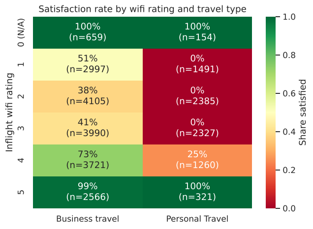
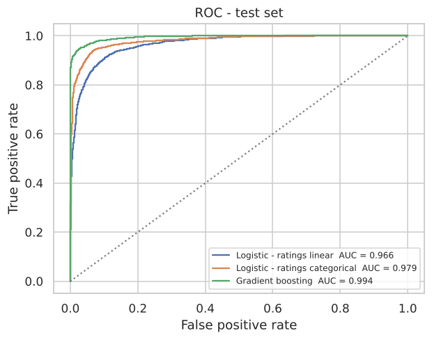
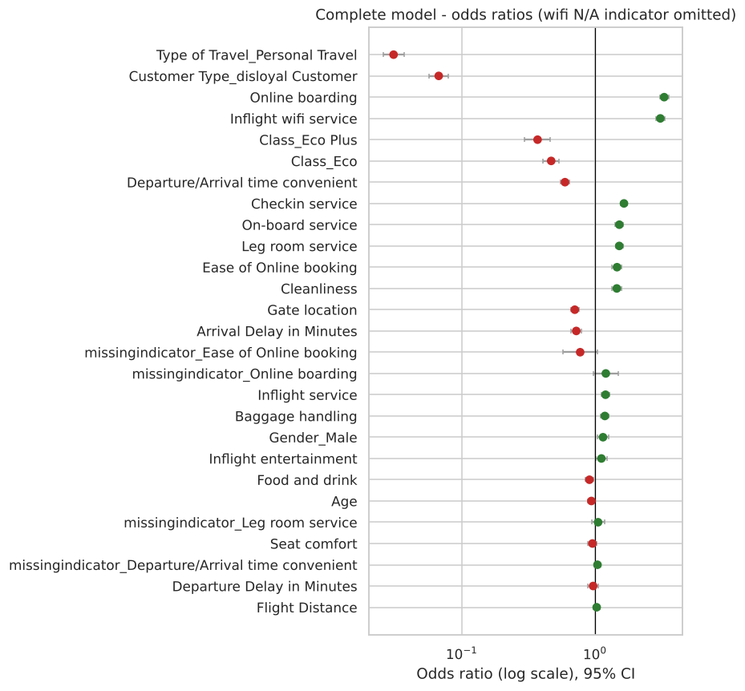

# Airline Passenger Satisfaction: Binary Logistic Regression

A driver analysis of 25,976 airline passengers. Which passengers leave satisfied, and which parts of the journey move that outcome? The logistic model is read through odds ratios with 95% confidence intervals, reduced with correlation and VIF rules, and benchmarked against gradient boosting to measure what linearity costs.

   

## Key results

| Model (test set, n = 5,196) | Features | Accuracy | Precision | Recall | Specificity | ROC-AUC |
|---|---|---|---|---|---|---|
| Logistic, complete | 28 | 0.903 | 0.882 | 0.900 | 0.906 | 0.966 |
| Logistic, optimised | 27 | 0.903 | 0.881 | 0.900 | 0.905 | 0.966 |
| Logistic, ratings as categories | 74 | 0.934 | 0.927 | 0.924 | 0.943 | 0.979 |
| Gradient boosting (benchmark) | 27 | 0.962 | 0.966 | 0.947 | 0.974 | 0.994 |

5-fold CV on the training set agrees within ±0.005 for every model.

**Findings**

1. **Segment dominates.** Personal travel (odds ratio 0.03) and disloyal customers (0.07) carry the largest effects. Business class reaches 70% satisfaction, against 19% in Economy.
2. **Controllable levers.** Online boarding (OR 3.3 per SD) and inflight wifi (3.1) lead, followed by check-in, on-board service and leg room (about 1.5 each). Seat comfort is not significant once the other ratings are controlled for.
3. **A rating of 0 means N/A, not "very bad".** The 813 passengers with wifi = 0 are 99.8% satisfied. Treating 0 as a score would invert the wifi effect for that group, so 0 is recoded as missing with an indicator.
4. **The non-linearity is a step.** Personal travellers who rate wifi 1–3 are never satisfied (0 of 6,203); at 5, all are. That explains most of the 6-point accuracy gap to gradient boosting. Encoding ratings as categories recovers about half of it without giving up interpretability.

<p align="center">
   <br>
  
</p>

## Approach

1. **EDA:** class balance, segment satisfaction rates, rating gaps by outcome, an N/A audit, delay skew and correlations.
2. **Preparation:** stratified 80/20 split. Every fitted step sits in a scikit-learn `Pipeline`: median imputation (with missing indicators for ratings that have 100+ N/A rows), `log1p` on delays, standard scaling and one-hot encoding.
3. **Complete model:** `LogisticRegression` for prediction, plus an unpenalised `statsmodels` Logit on the same design matrix for odds ratios, 95% confidence intervals and p-values.
4. **Optimised model:** drop one feature from any pair with |r| > 0.7, then iterate VIF > 5. Only departure delay was removed (r = 0.96 with arrival delay).
5. **Extensions:**
   - a gradient-boosting benchmark
   - wifi × travel-type analysis
   - a categorical-rating logistic model
   - a ranking of controllable drivers

## Repository structure

```
airline-satisfaction-logistic-regression/
├── data/airline.csv                     # 25,976 passengers, 22 predictors + target
├── notebooks/
│   └── airline_satisfaction_logistic_regression.ipynb   # executed, with outputs
├── outputs/
│   ├── figures/                         # 7 charts generated by the notebook
│   └── metrics/                         # CSV tables (odds ratios, model comparisons)
├── reports/Airline_Satisfaction_Logistic_Regression_Report.docx
├── requirements.txt
├── LICENSE
└── README.md
```

## How to run

```bash
git clone https://github.com/kashiprasadtn/airline-satisfaction-logistic-regression.git
cd airline-satisfaction-logistic-regression
python -m venv .venv && source .venv/bin/activate   # Windows: .venv\Scripts\activate
pip install -r requirements.txt
jupyter lab notebooks/airline_satisfaction_logistic_regression.ipynb
```

Run all cells (under a minute). `random_state = 42` is used throughout.

## Limitations

- Ratings and the label come from the same post-flight survey, so this is a **driver analysis**, not a pre-flight prediction model.
- Odds ratios are conditional associations, not causal effects. Departure/arrival time convenience and gate location have implausible negative signs and are not treated as levers.
- The near-deterministic wifi pattern suggests the dataset may be partly synthetic, so the findings describe this dataset rather than airline passengers in general.

## Data and attribution

- **Dataset:** the test partition (25,976 rows) of the *Airline Passenger Satisfaction* dataset published on Kaggle by TJ Klein, which is itself derived from an earlier Kaggle dataset by John D. It was supplied through upGrad coursework and is included for educational, non-commercial use; see the original Kaggle page for its terms.
- The analysis in `notebooks/` is my own implementation. It follows the section structure of an upGrad binary logistic regression demo, which is not reproduced here.
- Completed as part of the MS in Artificial Intelligence (Liverpool John Moores University, delivered via upGrad).

## Licence

Code is released under the [MIT License](LICENSE). The dataset is excluded (see above).
